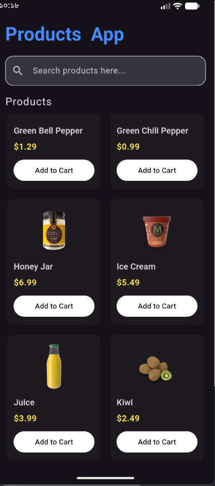
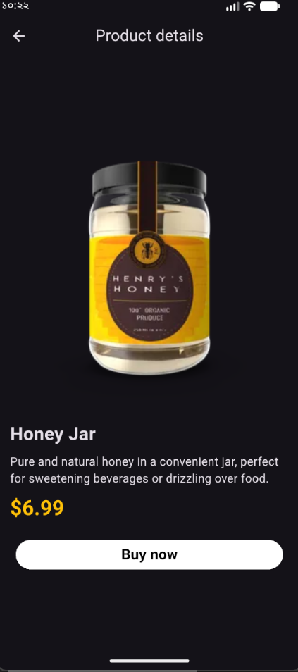

# Products App

A simple product browsing application built with Flutter, using a public API and BLoC state management.

## Features

- Fetch products from DummyJSON API
- Display products in a grid
- View product details
- Loading and error states
- BLoC state management
- API integration using Dio

## Technologies Used

- Flutter & Dart
- flutter_bloc
- Dio
- Equatable
- DummyJSON API

## Screenshots

<p align="center">
  
  &nbsp;&nbsp;
  
</p>

## Requirements

- Flutter SDK
- Android Studio or VS Code
- Internet connection

## Getting Started

### 1. Clone the repository

```bash
git clone https://github.com/ashrafCharlie/products-app
```

### 2. Navigate to the project directory

```bash
cd products-app
```

### 3. Install dependencies

```bash
flutter pub get
```

### 4. Run the application

```bash
flutter run
```

## API

This application uses the public DummyJSON Products API:

https://dummyjson.com/products

No API key is required.

An active internet connection is required to fetch product data.

## Platform Support
The application is built with Flutter and is intended for Android and iOS. iOS build and runtime have not been verified.

